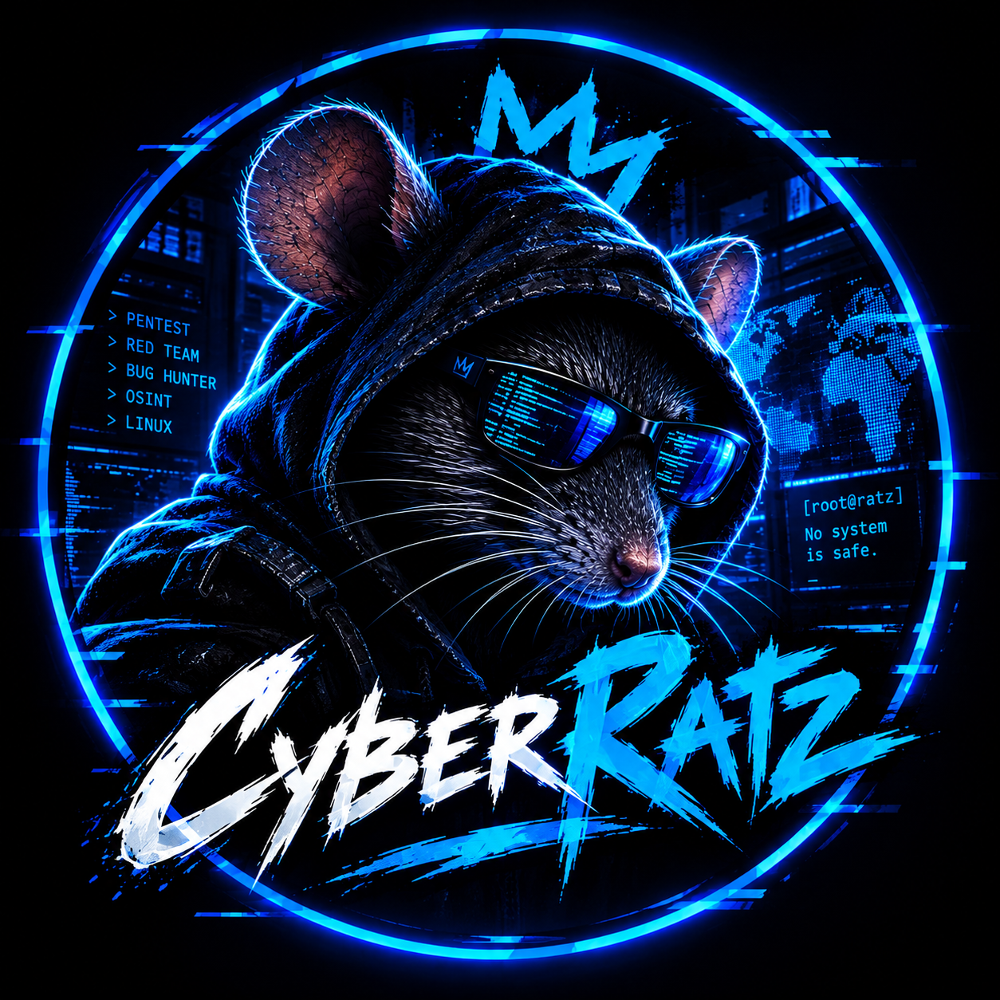
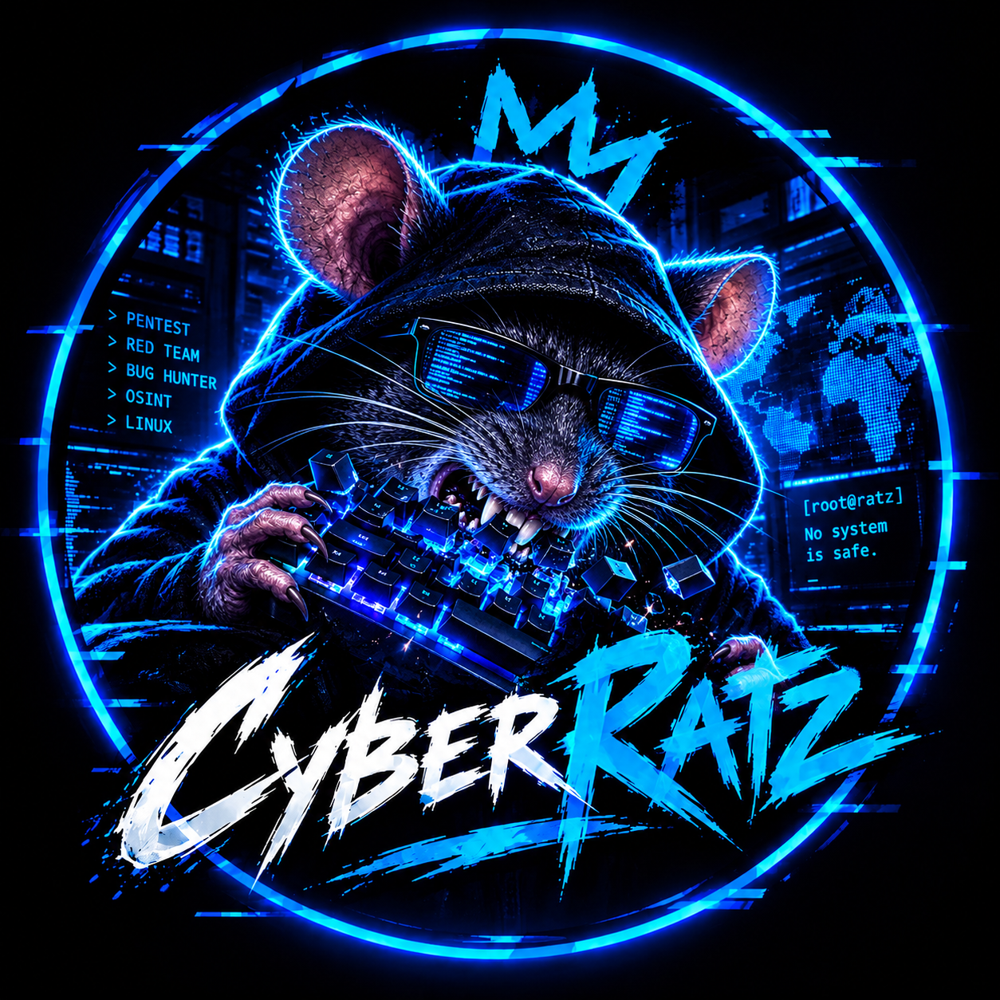

<!-- ═══════════════════════════════════════════════════════════
     CyberRatz — GitHub Profile README
     DA : #030405 · #19BEFF · #45E4FF · #EAF1F5 · #FF5A5A
     Username GitHub : cyberratzfr — pense à mettre le vrai lien Discord.
     ═══════════════════════════════════════════════════════════ -->

<div align="center">


<picture>
  <source media="(prefers-color-scheme: dark)" srcset="./assets/cyberratz-logo.png"/>
  <source media="(prefers-color-scheme: light)" srcset="./assets/cyberratz-logo-light.png"/>
  
</picture>

<a href="https://github.com/cyberratzfr">
  
</a>

<br/>


</div>

<br/>

<div align="center">
  
</div>

<br/>

## `>` WHOAMI ■

```bash
root@ratz:~# cat /etc/cyberratz/manifest

  ┌────────────────────────────────────────────────────────┐
  │  NAME     : CyberRatz                                  │
  │  TYPE     : Hackers éthiques & Bug Hunter              │
  │  HABITAT  : les égouts du réseau 🐀                    │
  │  MISSION  : apprendre, casser, documenter, partager    │
  │  RULE #1  : on ne touche qu'à ce qu'on a le droit      │
  │  MOTTO    : No system is safe.                         │
  └────────────────────────────────────────────────────────┘
```

> Les rats sont partout. Ils trouvent chaque fissure, chaque câble mal protégé, chaque porte entrouverte.
> **On fait pareil — mais avec un scope, une autorisation et un rapport à la fin.**

<br/>

## `>` OPERATIONS ■

<table>
  <tr>
    <td width="20%" align="center"><b>🎯 PENTEST</b></td>
    <td>Tests d'intrusion web, réseau et Active Directory. Méthodo, exploitation, rapport propre.</td>
  </tr>
  <tr>
    <td align="center"><b>🔴 RED TEAM</b></td>
    <td>Simulation d'adversaires, C2, évasion, post-exploitation — et AI Red Teaming.</td>
  </tr>
  <tr>
    <td align="center"><b>🐛 BUG HUNTER</b></td>
    <td>Chasse aux vulnérabilités sur programmes de bug bounty publics et privés.</td>
  </tr>
  <tr>
    <td align="center"><b>🕵️ OSINT</b></td>
    <td>Renseignement en sources ouvertes, reconnaissance, threat intel et veille leaks.</td>
  </tr>
  <tr>
    <td align="center"><b>🐧 LINUX</b></td>
    <td>Administration, hardening, scripting — le terrain de jeu naturel du rat.</td>
  </tr>
</table>

<br/>

## `>` ARSENAL ■

<div align="center">

**// OFFENSIVE**


**// CODE & SCRIPTING**


**// INFRA & LAB**


</div>

<br/>

## `>` RAT ACTIVITY ■

<div align="center">


</div>

<br/>

## `>` RULES OF ENGAGEMENT ■

```diff
+ [01] Scope autorisé uniquement — pas de permission, pas de test.
+ [02] Disclosure responsable — on signale, on ne divulgue pas sauvagement.
+ [03] On partage le savoir — writeups, outils, méthodo.
+ [04] Le respect dans le terrier — pas de gatekeeping, tout le monde a été débutant.
- [!!] Toute activité illégale = ban immédiat. Les rats ne mordent que là où c'est permis.
```

<br/>

## `>` JOIN THE SEWERS ■

<div align="center">

<a href="https://discord.gg/XXXXXXX">
  
</a>
<a href="https://instagram.com/hackee_fr">
  
</a>

<br/><br/>

```
root@ratz:~# exit
logout — connection closed by remote host.
```

<picture>
  <source media="(prefers-color-scheme: dark)" srcset="./assets/cyberratz-feral.png"/>
  <source media="(prefers-color-scheme: light)" srcset="./assets/cyberratz-feral-light.png"/>
  
</picture>

**`[root@ratz]` No system is safe.** 


</div>
